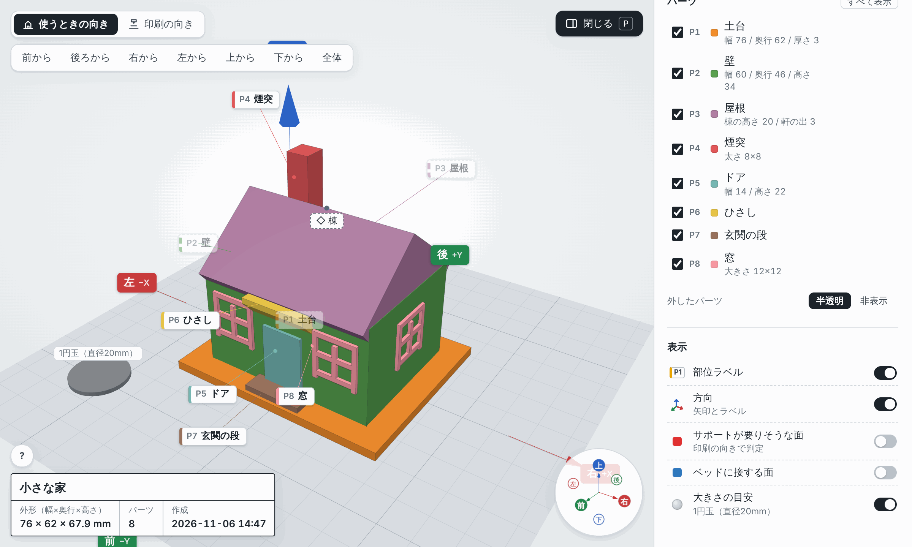

# ishimine-plugins

[English](README.md) | 日本語

Claude Code / Cowork 用のプラグインマーケットプレイスです。

## プラグイン

### [print3d-modeler](plugins/print3d-modeler/README.ja.md)

対話しながら、3D プリンタで印刷できるモデルを設計します。作りたいものを伝えると、Claude が大きさや形を質問しながら Python（build123d）でモデルを作り、独立した 2 体のレビュアーが印刷できるか・要望を満たしているかをチェックしたうえで、部位名と方向つきの 3D ビューアで見せます。納得できたら、印刷の向きに置いた 3MF / STL を出力します。FDM 3D プリンタでそのまま印刷できます。



進み方・ビューアの機能・設定は [プラグインの README](plugins/print3d-modeler/README.ja.md) をご覧ください。

## インストール

マーケットプレイスを追加してから、プラグインを入れます。

```
/plugin marketplace add TomokiIshimine/ishimine-plugins
/plugin install print3d-modeler@ishimine-plugins
```

## ライセンス

MIT（[LICENSE](LICENSE)）。同梱の three.js も MIT License です（`plugins/print3d-modeler/runtime/viewer/vendor/THREE_LICENSE.txt`）。
