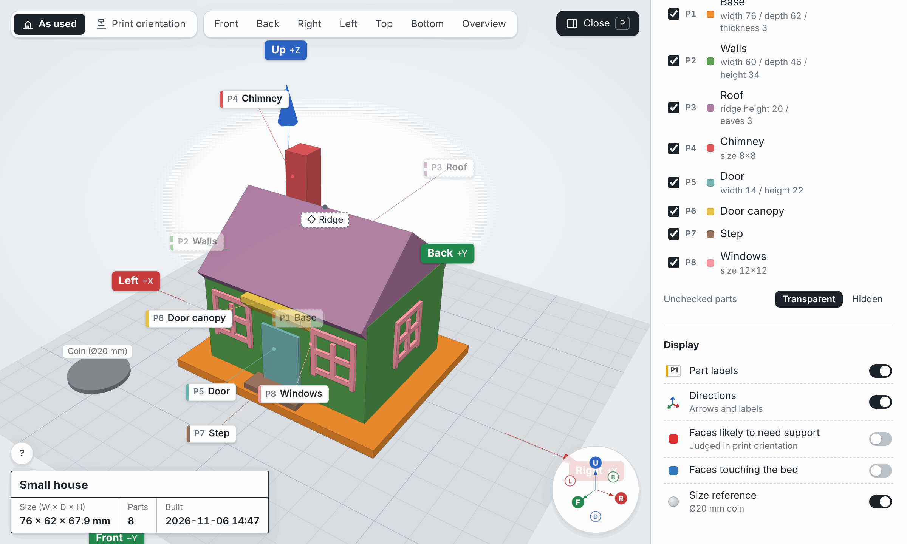

# ishimine-plugins

English | [日本語](README.ja.md)

A plugin marketplace for Claude Code and Cowork.

## Plugins

### [print3d-modeler](plugins/print3d-modeler/)

Design 3D printable models through conversation, with no Blender or other modeling software needed. Tell Claude what you want to make; it asks about size and shape, builds the model in Python (build123d), has two independent reviewers check printability and your requirements, and shows it to you in a 3D viewer with part names and directions. When you are happy with it, you get 3MF / STL files in print orientation, ready to print on a printer such as the Bambu Lab A1 mini.



See the [plugin README](plugins/print3d-modeler/) for the workflow, viewer features and settings.

## Install

In the Claude desktop app, open **Customize** in the left sidebar and go to the **Plugins** tab (in Cowork, open the **Cowork** tab first). Choose **Add** → **Add marketplace** → **Add from a repository**, enter `TomokiIshimine/ishimine-plugins`, then pick print3d-modeler from the list and add it. See the [plugin README](plugins/print3d-modeler/#install) for the steps and the official help.

In Claude Code, add the marketplace, then install the plugin:

```
/plugin marketplace add TomokiIshimine/ishimine-plugins
/plugin install print3d-modeler@ishimine-plugins
```

## License

MIT ([LICENSE](LICENSE)). The bundled three.js is also MIT licensed (`plugins/print3d-modeler/runtime/viewer/vendor/THREE_LICENSE.txt`).
