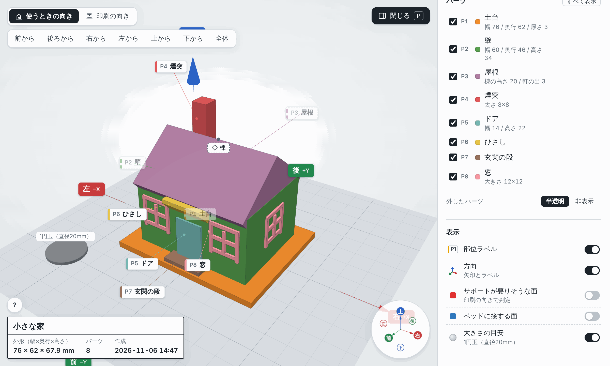
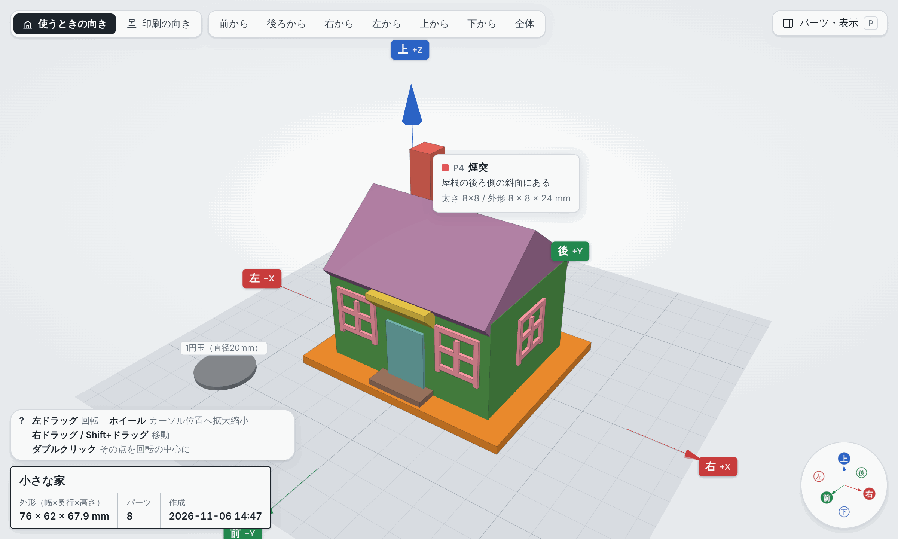
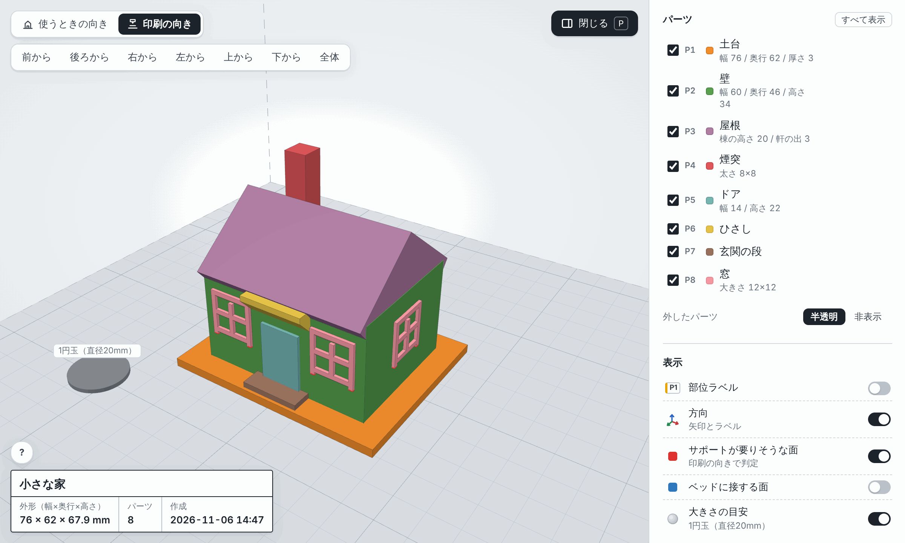

# print3d-modeler

[English](README.md) | 日本語

「こういうものを 3D プリンタで作りたい」と伝えると、Claude が対話しながら 3D モデルを一緒に設計するプラグインです。
**Blender などのモデリングソフトは不要**で、操作を覚える必要もありません。作りたいものを言葉で伝えるだけです。
大きさや形を質問しながら Python（build123d）でモデルを作り、独立した 2 体のレビュアーにチェックさせてから、3D ビューアで見せます。
納得できたら、**印刷の向きに置いた 3MF / STL** が手に入ります。スライサーに読み込めば、Bambu Lab A1 mini などのプリンタでそのまま印刷できます。

Claude デスクトップアプリの Cowork で動かす前提で作っています（Claude Code でも動きます）。claude.ai のチャットには対応していません（[使えるアプリ](#使えるアプリ)）。



## できること

- **作る前に聞きます。** 用途・大きさ・形・組み合わせ方・プリンタ機種を選択肢つきで質問し、答えを番号つきの要件（R1, R2…）として書き残します。
- **部位に名前をつけて設計します。** 「屋根」「煙突」「窓」のように部位に分けて作るので、あなたも Claude も部位名で話せます。
- **印刷できるかを実測で確かめます。** モデルを作るたびに、水密性・肉厚・オーバーハング・ブリッジ・ベッドとの接地・造形範囲を自動で計測します。
- **別の目でもチェックします。** 読み取り専用のサブエージェント 2 体が並行してレビューします。1 体は印刷できるか、もう 1 体は要望を満たしているかを見ます。指摘は最大 3 周まで Claude が直してから、あなたに見せます。
- **3D で確かめられます。** 1 ファイルの HTML ビューアに部位名と方向が出るので、「屋根を 5mm 高く」「煙突をもっと左へ」のようにチャットで指示できます。
- **印刷用ファイルを出力します。** 印刷の向きに置いた 3MF / STL と、推奨設定・サポートの要否をまとめた印刷メモを書き出します。

## インストール

```
/plugin marketplace add TomokiIshimine/ishimine-plugins
/plugin install print3d-modeler@ishimine-plugins
```

あとは自分の言葉で頼むだけです。頼み方は[使い方の例](#使い方の例)を参考にしてください。

## 使えるアプリ

| アプリ | 対応 | 補足 |
|---|---|---|
| Cowork（Claude デスクトップアプリ） | 対応 | 主な対象。手元のコンピュータの Python 環境で動きます |
| Claude Code | 対応 | ターミナル、IDE 拡張、デスクトップアプリの Code タブ |
| claude.ai のチャット（Web・デスクトップ・モバイル） | 非対応 | チャットではプラグインのサブエージェントが読み込まれずレビュー工程が動かないうえ、ランタイムを動かす手元の Python 環境もありません |

## 使い方の例

次のように話しかけて始めます。Claude は作り始める前に質問をしてきます。

- 「横向きのスマホを動画が見やすい角度で立てられるスタンドを 3D プリンタで作りたい」
- 「机に置くヘッドホンスタンドを作って。Bambu Lab A1 mini でサポートなしで印刷したい」
- 「小物入れにする、入れ子になる 3 つのフタ付きの箱を作って。一番大きいのは幅 100 mm くらい」
- 「煙突と窓のある高さ 60 mm くらいの小さな家を、机の飾りとして作って」
- 1 版目を見たあとに：「背もたれを 20 mm 高くして、ケーブル穴を左に寄せて」

## モデルができるまで

| 工程 | 何が起きるか | あなたがすること |
|---|---|---|
| 1. ヒアリング | 用途・大きさ・形・組み合わせ・プリンタについて質問されます | 選択肢から選ぶか、自分の言葉で答える |
| 2. 設計 | 部位に分け、寸法と印刷の向きを決めます | 要点を確認する |
| 3. 実装 | Claude が `model.py` を書いて実行し、自動計測で明らかな失敗を直します | なし |
| 4. レビュー | 独立した 2 体が印刷可能性と要望の充足をチェックします（修正は最大 3 周） | なし |
| 5. 確認 | 3D ビューアが開きます | 見回して、部位名と方向を使ってチャットで修正を伝える |
| 6. 出力 | 印刷の向きの 3MF / STL と印刷メモを書き出します | スライスして印刷する |

OK が出るまで 2〜5 を繰り返します。途中経過はすべて作業フォルダに残るので、どこで止めても `resume` で続きから再開できます。

## 3D ビューア

ビューアはモデルを確かめて、Claude に修正を伝えるための道具です。three.js を埋め込んだ 1 ファイルの HTML なので、アーティファクトとして表示でき、ブラウザで開けばオフラインでも動きます。

**細部まで自由に見られます。** ドラッグで回転、ホイールでカーソル位置へ拡大縮小、右ドラッグで移動、ダブルクリックでその点を回転の中心にします。上のボタンで前・後ろ・左右・上下・全体の視点に切り替えられます。

**どの部位が何という名前かわかります。** パーツにカーソルを合わせると、名前・説明・主な寸法が出ます。部位ラベル（P1 土台、P2 壁、P3 屋根…）と方向ラベル（上下・前後・左右）が、そのままチャットで使う言葉になります。方向ラベルには軸（前 −Y、右 +X、上 +Z）も添えてあります。左下の枠には、モデル名・外形寸法・パーツ数がいつも表示されます。



**表示を切り替えて、いろいろな観点で確かめられます。** 右上のボタン（または P キー）で開くパネルで、次のことができます。

- パーツごと、または印刷するオブジェクトごとに、表示・非表示・半透明を切り替える。
- **使うときの向き** と **印刷の向き** を切り替える。
- 印刷の向きで判定した **サポートが要りそうな面**（赤）と **ベッドに接する面**（青）を色分けする。
- 大きさの目安として 1 円玉（直径 20mm）を置く。

下の家は、軒・ひさし・窓枠の下面を斜めにしてあるので、サポートが要る面（赤）が無く、そのまま印刷できます。



スマホでは 3D 表示が画面いっぱいになり、ボタンはアイコンに、パネルは下から出るシートになります。パーツをタップすると名前が出ます。

ビューアの表示は日本語と英語に対応しています。

## スキル一覧

| 言い方の例 | スキル | すること |
|---|---|---|
| 「3Dプリンタでスマホスタンドを作りたい」／`/print3d-modeler:model スマホスタンド` | model | 新規作成の入口。ヒアリングから出力まで進める |
| 「さっきのモデルの続き」／`/print3d-modeler:resume` | resume | 作りかけのモデルを中断した工程から再開 |
| 「3Dで見せて」／`/print3d-modeler:view` | view | 3D ビューアを作り直して開く |
| 「レビューし直して」／`/print3d-modeler:review` | review | 印刷可能性・要望充足のレビューだけ再実行 |
| 「STLを出力して」／`/print3d-modeler:export` | export | 印刷の向きで 3MF / STL と印刷メモを書き出す |
| 「プリンタは A1 mini です」／`/print3d-modeler:printer` | printer | 造形範囲・ノズル径・材料を設定 |
| 「使い方を教えて」／`/print3d-modeler:help` | help | コマンド・作業の流れ・始め方を説明し、作業中のモデルも一覧で表示 |

## プリンタの設定

- 対象は FDM 方式のみです。
- 判定の既定値はノズル 0.4mm 前提です（肉厚 0.8mm 以上、オーバーハング 45° まで、ブリッジ 10mm まで、はめ合いのすき間 0.2〜0.4mm）。
- 造形範囲の既定は 220×220×250mm です。主要機種のプリセット（Bambu Lab A1 / A1 mini / P1S / X1C、Prusa MK4 / CORE One / MINI+、Creality Ender-3 V3 / K1 など）があり、どの値も個別に変えられます。

## 決まりごと

- 座標系: **上 = +Z（Z=0 がベッド面）、正面（手前）= −Y、右 = +X**、単位 mm。
- 方向はいつも「使うときの向き」が基準です。印刷の向きは回転として別に持つので、どちらの表示でも「上」の意味は変わりません。

## 作業フォルダ

選んだフォルダの下に `print3d/<モデル名>/` を作り、すべてをそこに残します。

```
print3d/
├── printer.json         プリンタ設定（全モデル共通）
└── small-house/
    ├── spec.md          要件（R1, R2…）とフィードバック
    ├── design.md        部位・寸法・印刷の向き
    ├── model.py         Python（build123d）のモデル
    ├── viewer.html      3D ビューア
    ├── reviews/         各周のレビュー結果
    ├── history.md       進み具合の記録（resume が使う）
    ├── print-notes.md   推奨設定とサポートの要否
    └── out/final/       印刷用の 3MF / STL
```

## 言語

プラグイン本体（スキル・エージェント・テンプレート・ランタイムのメッセージ）は英語で書かれていますが、Claude はあなたが書いた言語で会話します。
部位名や印刷メモなど、ユーザーが読むものもその言語で作ります。
ビューアの表示は **日本語と英語** に対応しています。Claude が会話の言語に合わせて選びます（`LabeledModel(..., lang="ja"|"en")` または `python -m p3d.viewer <フォルダ> --lang ja|en`）。指定が無い場合は、部位名が日本語なら日本語表示になります。

## 必要なもの

- Python 3.10 以上と、PyPI からパッケージを入れられるネットワーク（初回のみ）。
  初回に build123d・trimesh・manifold3d などを仮想環境（Claude Code が用意するプラグイン用のデータフォルダ、または `~/.print3d-modeler/venv`）へ自動で入れます。数分かかります。
- ビューアを開くための最新の Chrome / Edge / Safari / Firefox。

## 構成

```
print3d-modeler/
├── .claude-plugin/plugin.json
├── skills/            model, resume, view, review, export, printer, help（ユーザー向け）
│                      printability-rules, modeling-conventions（内部の判定基準・規約）
├── agents/            printability-reviewer, requirements-reviewer（読み取り専用のレビュアー）
└── runtime/           setup_env.sh, requirements.txt, p3d/（Python ライブラリ）, viewer/（テンプレートと three.js）
```

## プライバシーと通信

print3d-modeler にはサーバー・アカウント・API キー・テレメトリはありません。あなたや会話についてのデータを集めたり送ったりはしません。

- **ダウンロードするもの**：初回と、`runtime/requirements.txt` が変わったときだけ、`runtime/setup_env.sh` が `pip` で build123d・trimesh・manifold3d とその依存パッケージを PyPI（pypi.org と files.pythonhosted.org）から取得します。それ以外にネットワークから取得するものはありません。
- **実行するもの**：`setup_env.sh`（仮想環境を作ってパッケージを入れる）、Claude がモデルごとに書く `model.py`、プラグイン自身の Python モジュール（`python -m p3d.…`）。どれも手元で動きます。
- **書き込む場所**：モデルは選んだフォルダの下の `print3d/` に保存します。Python 環境は Claude Code が用意するプラグイン用のデータフォルダ、無ければ `~/.print3d-modeler/` に作ります。それ以外の場所には書き込みません。
- **ビューア**：`viewer.html` はネットワークから何も読み込みません。Claude がアーティファクトとして表示した場合、そのファイル（モデルの形と部位名）は他のアーティファクトと同じくあなたの Claude アカウントに保存されます。避けたい場合はそう伝えて、手元のファイルをブラウザで開いてください。

## 困ったとき

| 症状 | 対処 |
|---|---|
| 「Python 3.10 or later was not found」と出る | Python 3.10 以上（python.org、Homebrew、パッケージマネージャなど）を入れて、新しいセッションで始め直す |
| 初回のパッケージのインストールで失敗する | pypi.org につながるか確認し（プロキシやファイアウォールで止められていることがあります）、Claude にセットアップのやり直しを頼む。何度も失敗するときは下の仮想環境を消してやり直す |
| 更新のあとパッケージがおかしい | プラグイン用のデータフォルダの `venv`（または `~/.print3d-modeler/venv`）を消す。次の実行で作り直されます |
| ビューアがアーティファクトとして開かない | モデルのフォルダにある `viewer.html` を Chrome・Edge・Safari・Firefox で開く。オフラインでも動きます |
| プリンタに収まらない | 機種か造形範囲を伝え（`/print3d-modeler:printer`）、モデルを確認し直すよう頼む |
| 前に作りかけたモデルを続けたい | 「前のモデルの続き」と頼むか `/print3d-modeler:resume` |

## サポート

- 質問・不具合の報告・要望：[GitHub Issues](https://github.com/TomokiIshimine/ishimine-plugins/issues)
- セキュリティの問題：公開の Issue ではなく、リポジトリの [Security タブ](https://github.com/TomokiIshimine/ishimine-plugins/security) の **Report a vulnerability** から非公開で報告してください。

## ライセンス

MIT License（[LICENSE](LICENSE)）。

ビューアをオフラインで動かすため、three.js（MIT License、r160）を `runtime/viewer/vendor/` に同梱しています。`three-bundle.partNN.js` は手書きではなく生成物です。npm パッケージ `three@0.160.0` を `three-bundle.entry.js` から esbuild 0.24.2 で圧縮せずに 1 本の読めるスクリプトにまとめ（中身は three.js・`OrbitControls`・`CSS2DRenderer` だけ）、256 KiB 未満のファイルに分けたものです。ビューアは順に連結して使います。作り直すときはリポジトリの `.github/scripts/build_three_bundle.py` を実行します（`--check` で同梱分が新しくビルドしたものと一致するか確かめられます）。three.js のライセンスは同じフォルダの `THREE_LICENSE.txt` にあります。
