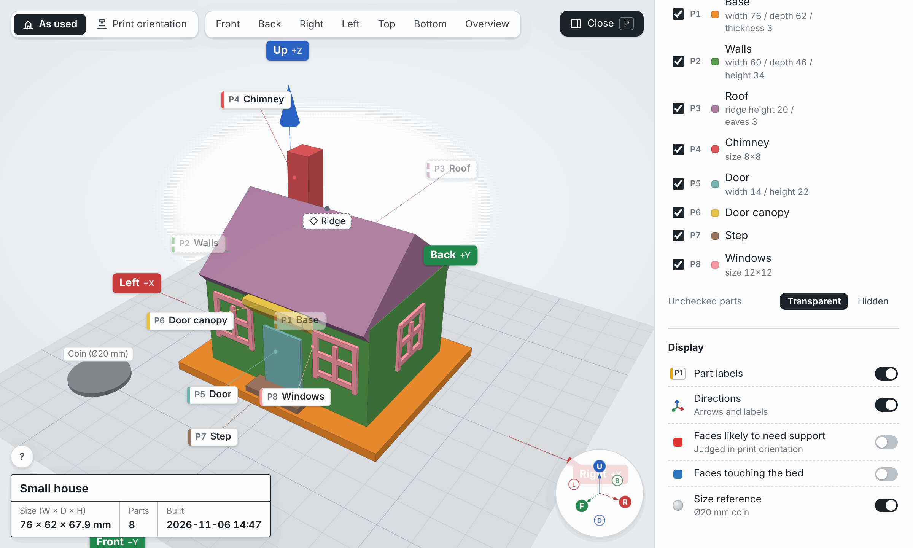
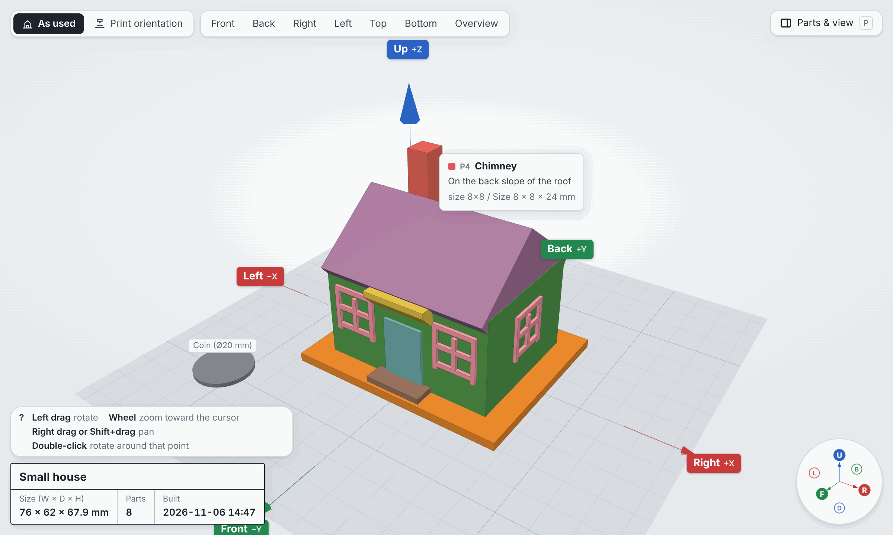
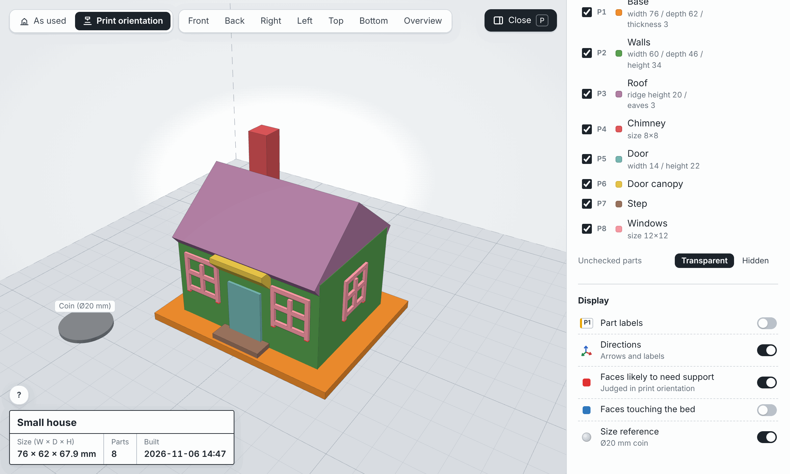

# print3d-modeler

English | [日本語](README.ja.md)

Tell Claude what you want to make with your 3D printer, and it designs the model with you through conversation.
**No Blender or other modeling software needed**, and nothing new to learn: you just describe what you want.
Claude asks about size and shape, writes the model in Python (build123d), has it checked by two independent reviewers, and shows it to you in a 3D viewer.
When you are happy with it, you get **3MF / STL files placed in print orientation**. Open them in your slicer and print them on a printer such as the Bambu Lab A1 mini.

Built for Cowork in the Claude app (desktop and phone). It also works in Claude Code. It does not support the chat screen on claude.ai (web, desktop, mobile) (see [Where it works](#where-it-works)).



## What it does

- **Asks before it builds.** Claude asks multiple-choice questions about purpose, size, shape, how parts fit together and your printer, and writes the answers down as numbered requirements (R1, R2…).
- **Designs in named parts.** The model is split into parts such as "Roof", "Chimney" or "Windows", so you and Claude can refer to them by name.
- **Checks printability with real measurements.** Watertightness, wall thickness, overhangs, bridges, bed contact and build volume are measured automatically after every build.
- **Gets a second opinion.** Two read-only subagents review the model in parallel: one checks whether it will print, the other whether it meets your requirements. Claude fixes what they find, up to 3 rounds, before showing you anything.
- **Lets you see it in 3D.** A single-file HTML viewer shows the model with part names and directions, so you can say "make the roof 5 mm higher" or "move the chimney to the left".
- **Exports print-ready files.** 3MF / STL in print orientation, plus print notes with recommended settings and whether supports are needed.

## Install

You can install it from the screens of the Claude desktop app (official help: [Use plugins in Claude](https://support.claude.com/en/articles/13837440-use-plugins-in-claude)).

1. In the left sidebar, open **Customize** and go to the **Plugins** tab.
   In Cowork, open the **Cowork** tab first, then open **Customize**.
2. Choose **Add**, then **Add marketplace**.
3. Choose **Add from a repository** and enter `TomokiIshimine/ishimine-plugins`.
4. Pick print3d-modeler from the marketplace's list and add it.

To install it in Claude Code, run these two lines:

```
/plugin marketplace add TomokiIshimine/ishimine-plugins
/plugin install print3d-modeler@ishimine-plugins
```

Then just ask in your own words. See [Examples](#examples) for ideas.

## Where it works

| App | Supported | Notes |
|---|---|---|
| Cowork (Claude desktop app, Claude app on your phone) | Yes | The main target. Runs in an environment in Claude's cloud. Besides the desktop app, you can use it from Cowork in the Claude app on your phone (modeling from your phone works too) |
| Claude Code | Yes | The desktop app's Code tab (recommended). The terminal and IDE extensions work too |
| Chat on claude.ai (the chat screen on web, desktop, mobile) | No | The chat screen does not load plugin subagents, so the review step cannot run |

## Examples

Start a conversation with a request like one of these. Claude asks follow-up questions before it builds anything.

- "I want to 3D print a phone stand that holds my phone in landscape at a comfortable angle for watching videos."
- "Make a headphone stand for my desk. It should print without supports on a Bambu Lab A1 mini."
- "Design a set of three nesting boxes with lids for small parts, the largest about 100 mm wide."
- "Make a small house model about 60 mm tall with a chimney and windows, as a desk ornament."
- After the first version: "Make the backrest 20 mm taller and move the cable hole to the left."

## How a model is made

| Step | What happens | What you do |
|---|---|---|
| 1. Hearing | Claude asks about purpose, size, shape, fit and your printer | Pick from the options, or answer in your own words |
| 2. Design | The model is split into named parts, and dimensions and print orientation are decided | Confirm the key points |
| 3. Build | Claude writes `model.py` and runs it, fixing obvious failures using the automatic measurements | Nothing |
| 4. Review | Two independent reviewers check printability and requirements (up to 3 rounds of fixes) | Nothing |
| 5. Your check | The 3D viewer opens | Look around and give changes in chat, using part names and directions |
| 6. Export | 3MF / STL in print orientation and print notes are written | Slice and print |

Steps 2 to 5 repeat until you say it is good. Everything is saved to a working folder, so you can stop at any point and continue later with `resume`.

## The 3D viewer

The viewer is how you check the model and tell Claude what to change. Claude shows it as an artifact, so you normally look at it right inside Claude.

Also: the viewer is one self-contained HTML file (`viewer.html` in the model's folder, three.js embedded), so it also works offline if you open the local file in a browser.

**Look at any detail.** Drag to rotate, scroll to zoom toward the cursor, right-drag to pan, and double-click a point to rotate around it. The buttons at the top jump to front, back, left, right, top, bottom or an overview.

**Know what every part is called.** Hover over a part to see its name, description and key dimensions; click it (or tap it on a phone) to copy its name, ready to paste into chat. Part labels (P1 Base, P2 Walls, P3 Roof…) and the direction labels (up/down, front/back, left/right) give you the words to use in chat; each direction label also shows its axis (front −Y, right +X, up +Z). The box at the bottom left keeps the model name, overall size and part count in view.



**Switch views to check different things.** The panel at the top right (or the P key) lets you:

- Show, hide or make parts transparent, one by one or per printed object.
- Switch between the model **as used** and in **print orientation**.
- Highlight **faces likely to need support** (red) and **faces touching the bed** (blue), judged in print orientation.
- Show a Ø20 mm coin for scale.

In the house below, the eaves, the door canopy and the window frames are shaped with sloped undersides, so no face is flagged as needing support and it prints as is.



On a phone, the 3D view fills the screen, the buttons become icons, the panel slides up from the bottom, and tapping a part shows its name.

The viewer UI is available in English and Japanese.

## Skills

| Example request | Skill | What it does |
|---|---|---|
| "I want to 3D print a phone stand" / `/print3d-modeler:model phone stand` | model | Entry point for a new model. Runs everything from hearing to export |
| "Continue the model from earlier" / `/print3d-modeler:resume` | resume | Resumes an unfinished model from the step where it stopped |
| "Show it in 3D" / `/print3d-modeler:view` | view | Rebuilds and opens the 3D viewer |
| "Review it again" / `/print3d-modeler:review` | review | Reruns only the printability and requirements reviews |
| "Export the STL" / `/print3d-modeler:export` | export | Writes 3MF / STL in print orientation plus print notes |
| "My printer is an A1 mini" / `/print3d-modeler:printer` | printer | Sets and remembers your printer (build volume, nozzle size, material) |
| "How do I use this?" / `/print3d-modeler:help` | help | Explains the commands, the workflow and how to get started, and lists your models in progress |

## Printer settings

- FDM printers only.
- Default thresholds assume a 0.4 mm nozzle: walls at least 0.8 mm, overhangs up to 45°, bridges up to 10 mm, fit clearance 0.2–0.4 mm.
- The build volume defaults to 220×220×250 mm. Presets cover the main Bambu Lab printers (A1 mini, A1, P1P, P1S, P2S, X1 Carbon, X1E, X2D, H2S, H2D / H2D Pro, H2C, H3C; volumes from Bambu Lab's spec pages) and other popular printers (Prusa MK4 / CORE One / MINI+, Creality Ender-3 V3 / K1, and others). Any value can be overridden.
- Tell Claude your printer once: it is saved in `print3d/printer.json` and remembered for your next models (in the plugin's data folder, and in Claude's memory where the app has one).
- Pieces are laid out on your printer's bed for printing: turned 90° or diagonally when that is what makes them fit, and packed onto one plate when they can be. If they need more than one plate, Claude tells you and exports one 3MF per plate; if a piece does not fit your printer at all, Claude warns you and suggests splitting or scaling it.

## Conventions

- Coordinates: **up = +Z (Z=0 is the bed), front = −Y, right = +X**, in millimeters.
- Directions always refer to the model as used. The print orientation is stored separately as a rotation, so "up" means the same thing in both views.

## Working folder

Claude creates `print3d/<model-name>/` under the folder you choose and keeps everything there:

```
print3d/
├── printer.json         printer settings shared by all models (your remembered printer applies if it is missing)
└── small-house/
    ├── spec.md          requirements (R1, R2…) and your feedback
    ├── design.md        parts, dimensions, print orientation
    ├── model.py         the model in Python (build123d)
    ├── viewer.html      the 3D viewer
    ├── reviews/         results of each review round
    ├── history.md       progress log, used by resume
    ├── print-notes.md   recommended settings and support advice
    └── out/final/       3MF / STL to print
```

## Language

The plugin itself (skills, agents, templates, runtime messages) is written in English, but Claude talks to you in the language you write in.
Part names, the print notes and other files you read are written in that language too.
The viewer UI is available in **English and Japanese**. Claude picks the one that matches your conversation (`LabeledModel(..., lang="en"|"ja")`, or `python -m p3d.viewer <dir> --lang en|ja`). If not set, it switches to Japanese when the part names are Japanese.

## Requirements

- Just the Claude app (Cowork or Claude Code). Python is already installed in the environments in Claude's cloud, so **you do not need to set up Python on your computer** (if you run Claude Code on your own computer, see the note below).

Also:

- If you run Claude Code on your own computer (the terminal, IDE extensions, or the desktop app's Code tab with a local environment), it uses Python 3.10 or later on that computer. If none is found you see "Python 3.10 or later was not found"; only then do you need to install it (see [Troubleshooting](#troubleshooting)).
- On first run only, it installs build123d, trimesh, manifold3d and others from PyPI into a virtual environment (in the plugin's data folder that Claude Code provides, or `~/.print3d-modeler/venv`). This takes a few minutes and needs network access to PyPI.

## Layout

```
print3d-modeler/
├── .claude-plugin/plugin.json
├── skills/            model, resume, view, review, export, printer, help (user-facing)
│                      printability-rules, modeling-conventions (internal rules and conventions)
├── agents/            printability-reviewer, requirements-reviewer (read-only reviewers)
└── runtime/           setup_env.sh, requirements.txt, p3d/ (Python library), viewer/ (template and three.js)
```

## Privacy and network

print3d-modeler has no server, account, API key or telemetry. It does not collect or send any data about you or your conversations. The full policy is in [PRIVACY.md](PRIVACY.md).

- **What it downloads.** On first run, and again only when `runtime/requirements.txt` changes, `runtime/setup_env.sh` runs `pip` to download build123d, trimesh, manifold3d and their dependencies from PyPI (pypi.org and files.pythonhosted.org). Nothing else is fetched from the network.
- **What it runs.** `setup_env.sh` (creates the virtual environment and installs the packages), the `model.py` that Claude writes for your model, and the plugin's own Python modules (`python -m p3d.…`). All of them run in the environment where Claude runs commands: in Cowork, an environment in Claude's cloud; in Claude Code on your own computer, that computer.
- **Where it writes.** Your models go in `print3d/` under the folder you choose. The Python environment goes in the same environment, in the plugin's data folder that Claude Code provides, or `~/.print3d-modeler/` when there is none. Nothing is written anywhere else.
- **The viewer.** `viewer.html` loads nothing from the network. When Claude shows it as an artifact, the file (the model's shape and part names) is stored in your Claude account like any other artifact. Ask Claude not to, and open the local `viewer.html` instead, if you prefer.

## Troubleshooting

| Problem | What to do |
|---|---|
| "Python 3.10 or later was not found" (when using Claude Code on your own computer) | Install Python 3.10 or later on that computer (python.org, Homebrew, or your package manager) and start a new session. This does not normally happen in Cowork or in a cloud environment |
| The first run fails while installing packages | Check that pypi.org is reachable (a proxy or firewall may block it), then ask Claude to run the setup again. If it keeps failing, delete the virtual environment (below) and retry |
| Packages are broken after an update | Delete the `venv` folder in the plugin's data folder (or `~/.print3d-modeler/venv`). It is recreated on the next run |
| The viewer does not open as an artifact | Open the local `viewer.html` in the model's folder. It works offline |
| The model does not fit your printer | Tell Claude your printer model or build volume (`/print3d-modeler:printer`), then ask it to check the model again |
| You want to continue an earlier model | Ask "continue the model from earlier" or run `/print3d-modeler:resume` |

## Support

- Questions, bug reports and feature requests: [GitHub Issues](https://github.com/TomokiIshimine/ishimine-plugins/issues).
- Security problems: report them privately with **Report a vulnerability** on the repository's [Security tab](https://github.com/TomokiIshimine/ishimine-plugins/security), not in a public issue.

## License

MIT License (see [LICENSE](LICENSE)).

three.js (MIT License, r160) is bundled in `runtime/viewer/vendor/` so that the viewer works offline. The `three-bundle.partNN.js` files are generated, not hand-written: they are the npm package `three@0.160.0` bundled by esbuild 0.24.2 from `three-bundle.entry.js` as one readable, unminified script (three.js, `OrbitControls` and `CSS2DRenderer` only), split into parts under 256 KiB. The viewer joins them in order. To rebuild them, run `.github/scripts/build_three_bundle.py` in the repository (`--check` confirms the committed parts match a fresh build). The three.js license is in `THREE_LICENSE.txt` next to them.
