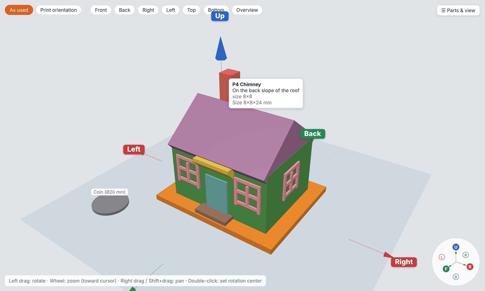
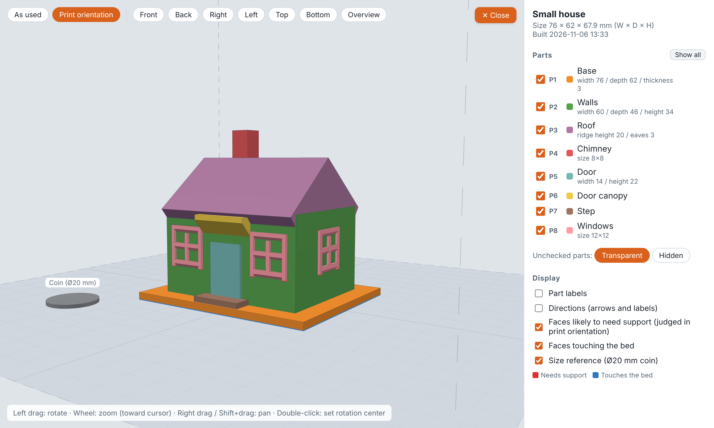

# print3d-modeler

English | [日本語](README.ja.md)

Tell Claude what you want to make with your 3D printer, and it designs the model with you through conversation.
Claude asks about size and shape, writes the model in Python (build123d), has it checked by two independent reviewers, and shows it to you in a 3D viewer.
When you are happy with it, you get **3MF / STL files placed in print orientation, ready to slice and print on an FDM 3D printer**.

Built for Cowork in the Claude desktop app. It also works in Claude Code.


## What it does

- **Asks before it builds.** Claude asks multiple-choice questions about purpose, size, shape, how parts fit together and your printer, and writes the answers down as numbered requirements (R1, R2…).
- **Designs in named parts.** The model is split into parts such as "Roof", "Chimney" or "Windows", so you and Claude can refer to them by name.
- **Checks printability with real measurements.** Watertightness, wall thickness, overhangs, bridges, bed contact and build volume are measured automatically after every build.
- **Gets a second opinion.** Two read-only subagents review the model in parallel: one checks whether it will print, the other whether it meets your requirements. Claude fixes what they find, up to 3 rounds, before showing you anything.
- **Lets you see it in 3D.** A single-file HTML viewer shows the model with part names and directions, so you can say "make the roof 5 mm higher" or "move the chimney to the left".
- **Exports print-ready files.** 3MF / STL in print orientation, plus print notes with recommended settings and whether supports are needed.

## Install

```
/plugin marketplace add TomokiIshimine/ishimine-plugins
/plugin install print3d-modeler@ishimine-plugins
```

Then just ask, for example: "I want to 3D print a phone stand".

## How a model is made

| Step | What happens | What you do |
|---|---|---|
| 1. Hearing | Claude asks about purpose, size, shape, fit and your printer | Pick from the options, or answer in your own words |
| 2. Design | The model is split into named parts, and dimensions and print orientation are decided | Confirm the key points |
| 3. Build | Claude writes `model.py` and runs it, fixing obvious failures using the automatic measurements | Nothing |
| 4. Review | Two independent reviewers check printability and requirements (up to 3 rounds of fixes) | Nothing |
| 5. Your check | The 3D viewer opens | Look around and give changes in chat, using part names and directions |
| 6. Export | 3MF / STL in print orientation and print notes are written | Slice and print |

Steps 2 to 5 repeat until you say it is good. Everything is saved to a working folder, so you can stop at any point and continue later with `resume`.

## The 3D viewer

The viewer is how you check the model and tell Claude what to change. It is one self-contained HTML file (three.js embedded): it can be shown as an artifact, and it works offline when opened in a browser.

**Look at any detail.** Drag to rotate, scroll to zoom toward the cursor, right-drag to pan, and double-click a point to rotate around it. The buttons at the top jump to front, back, left, right, top, bottom or an overview.

**Know what every part is called.** Hover over a part to see its name, description and key dimensions. Part labels (P1 Base, P2 Walls, P3 Roof…) and the direction labels (up/down, front/back, left/right) give you the words to use in chat.



**Switch views to check different things.** The panel at the top right (or the P key) lets you:

- Show, hide or make parts transparent, one by one or per printed object.
- Switch between the model **as used** and in **print orientation**.
- Highlight **faces likely to need support** (red) and **faces touching the bed** (blue), judged in print orientation.
- Show a Ø20 mm coin for scale.

In the house below, the eaves, the door canopy and the window frames are shaped with sloped undersides, so no face is flagged as needing support and it prints as is.



The viewer UI is available in English and Japanese.

## Skills

| Example request | Skill | What it does |
|---|---|---|
| "I want to 3D print a phone stand" / `/print3d-modeler:model phone stand` | model | Entry point for a new model. Runs everything from hearing to export |
| "Continue the model from earlier" / `/print3d-modeler:resume` | resume | Resumes an unfinished model from the step where it stopped |
| "Show it in 3D" / `/print3d-modeler:view` | view | Rebuilds and opens the 3D viewer |
| "Review it again" / `/print3d-modeler:review` | review | Reruns only the printability and requirements reviews |
| "Export the STL" / `/print3d-modeler:export` | export | Writes 3MF / STL in print orientation plus print notes |
| "My printer is an A1 mini" / `/print3d-modeler:printer` | printer | Sets build volume, nozzle size and material |

## Printer settings

- FDM printers only.
- Default thresholds assume a 0.4 mm nozzle: walls at least 0.8 mm, overhangs up to 45°, bridges up to 10 mm, fit clearance 0.2–0.4 mm.
- The build volume defaults to 220×220×250 mm. Presets are included for popular printers (Bambu Lab A1 / A1 mini / P1S / X1C, Prusa MK4 / CORE One / MINI+, Creality Ender-3 V3 / K1, and others), and any value can be overridden.

## Conventions

- Coordinates: **up = +Z (Z=0 is the bed), front = −Y, right = +X**, in millimeters.
- Directions always refer to the model as used. The print orientation is stored separately as a rotation, so "up" means the same thing in both views.

## Working folder

Claude creates `print3d/<model-name>/` under the folder you choose and keeps everything there:

```
print3d/
├── printer.json         printer settings shared by all models
└── small-house/
    ├── spec.md          requirements (R1, R2…) and your feedback
    ├── design.md        parts, dimensions, print orientation
    ├── model.py         the model in Python (build123d)
    ├── viewer.html      the 3D viewer
    ├── reviews/         results of each review round
    ├── history.md       progress log, used by resume
    ├── print-notes.md   recommended settings and support advice
    └── out/final/       3MF / STL to print
```

## Language

The plugin itself (skills, agents, templates, runtime messages) is written in English, but Claude talks to you in the language you write in.
Part names, the print notes and other files you read are written in that language too.
The viewer UI is available in **English and Japanese**. Claude picks the one that matches your conversation (`LabeledModel(..., lang="en"|"ja")`, or `python -m p3d.viewer <dir> --lang en|ja`). If not set, it switches to Japanese when the part names are Japanese.

## Requirements

- Python 3.10 or later, and network access to PyPI on first run.
  On first run it installs build123d, trimesh, manifold3d and others into a virtual environment (`$CLAUDE_PLUGIN_DATA` or `~/.print3d-modeler/venv`). This takes a few minutes.
- A recent Chrome, Edge, Safari or Firefox to open the viewer.

## Layout

```
print3d-modeler/
├── .claude-plugin/plugin.json
├── skills/            model, resume, view, review, export, printer (user-facing)
│                      printability-rules, modeling-conventions (internal rules and conventions)
├── agents/            printability-reviewer, requirements-reviewer (read-only reviewers)
└── runtime/           setup_env.sh, requirements.txt, p3d/ (Python library), viewer/ (template and three.js)
```

three.js (MIT License) is bundled in `runtime/viewer/vendor/`. To update it, bundle `runtime/viewer/vendor/three-bundle.entry.js` with esbuild (`--bundle --minify --format=iife`) to regenerate `three-bundle.js`.
